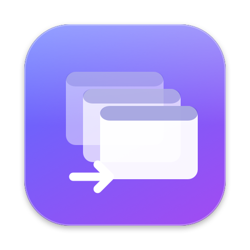

<p align="center">
  
</p>

<h1 align="center">MacAltTab</h1>

<p align="center"><a href="README.md">English version</a></p>

Une bascule entre fenêtres pour macOS, façon Windows, en **Liquid Glass** et **sans autorisation d'enregistrement de l'écran**.

## Pourquoi

`⌘ ⇥` bascule entre les apps, pas entre les fenêtres. Avec cinq projets VS Code ou trois fenêtres Chrome, on les cherche. AltTab règle ce problème, mais ses aperçus de fenêtres demandent l'enregistrement de l'écran, une autorisation qui permet de tout voir.

MacAltTab affiche l'icône de l'app et le titre de la fenêtre. L'Accessibilité suffit.

## Fonctions

- **Toutes les fenêtres, tous les bureaux** : autres bureaux, fenêtres réduites, apps masquées, apps ouvertes sans fenêtre.
- **Raccourci** : `⌥ ⇥` par défaut, modifiable depuis la barre des menus. `⇧` pour reculer.
- **Bascule rapide** : un `⌥ ⇥` tapé vite revient à la fenêtre précédente sans afficher la grille.
- **Groupes** : fenêtres ouvertes, réduites et apps sans fenêtre sur des lignes séparées, avec titres (option).
- **Ordre** : utilisation récente, ou alphabétique pour que les tuiles ne bougent jamais.
- **Tailles** : S, M ou L.
- **Recherche** : tape pendant que la grille est ouverte pour filtrer.
- **Onglets Chrome, Safari et Terminal** : liste à côté de la grille. Clic, ou `⇧ ↓ ⇧ ↑` puis `↩`.
- **Actions au survol** : fermer, réduire, plein écran, quitter, sous l'icône.
- **Pastilles du Dock** : messages non lus sur les tuiles.
- **Au relâchement de `⌥`** : valider tout de suite, ou garder la grille ouverte jusqu'au clic ou `↩` (par défaut, pour éviter les bascules involontaires).
- **Clic sur l'app** : ouvre la grille comme le raccourci.
- **Lancement à l'ouverture de session** : un clic dans le menu.

## Touches

| Touche | Action |
|---|---|
| `⌥ ⇥` / `⇧ ⌥ ⇥` | Suivante / précédente |
| `← → ↑ ↓` | Se déplacer dans la grille |
| `⇧ ↓` / `⇧ ↑` | Se déplacer dans les onglets |
| `↩` | Aller à la fenêtre (ou à l'onglet) |
| `⎋` | Annuler |
| Lettres | Filtrer |

## Autorisations

| Autorisation | Pourquoi |
|---|---|
| Accessibilité | Lister les fenêtres, lire les titres, activer une fenêtre, écouter `⌥` |
| Automatisation (Chrome, Safari, Terminal) | Lire et choisir les onglets. Facultative : refusée, la liste des onglets ne s'affiche pas |

Pas d'enregistrement de l'écran. Aucun accès réseau.

## Installation

Télécharge le DMG dans [Releases](../../releases), ouvre-le et glisse MacAltTab dans Applications. Il est signé et notarisé.

Au premier lancement, autorise MacAltTab dans **Réglages Système → Confidentialité et sécurité → Accessibilité**.

## Compilation

macOS 26 et Xcode 26.

```sh
./build.sh               # compile, signe, installe dans /Applications et lance
./build.sh --no-install  # compile seulement (build/MacAltTab.app)
./build.sh --notarize    # notarise aussi (profil de trousseau « notary »)
```

Sans certificat Developer ID : `SIGN_IDENTITY=- ./build.sh`.

## Publier une version

`git tag v1.0.1 && git push origin v1.0.1` : GitHub Actions compile, signe, notarise et publie le DMG.

## Licence

GPL-3.0
